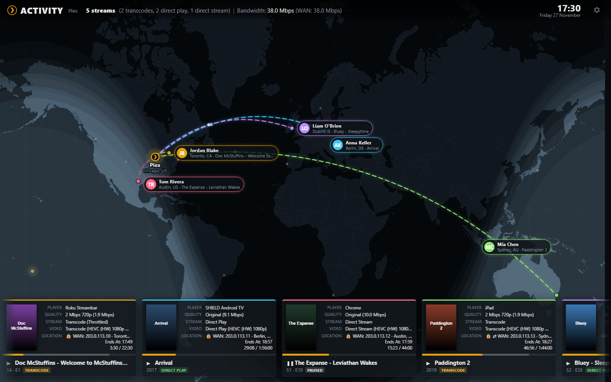

# WhereInTheWorld

**See who's streaming from your Plex server, and where in the world they are.**

WhereInTheWorld is a full-screen live map of your Plex activity. Every stream gets an animated flight-path arc from your server to the viewer's city, plus an activity card showing what they're watching and how it's being delivered. It's made for a spare screen on the wall, but it works just as well in a window on your desktop.



<sub>Screenshot from demo mode: all viewers and streams are made up.</sub>

## Features

- **Live arcs** from your server to each viewer. They move faster at higher bandwidth, freeze when a stream is paused and blink red while it buffers.
- **Activity cards** with the same detail as Tautulli's Activity page: poster, product, player, quality, and stream / container / video / audio / subtitle decisions (including hardware transcoding). Each card also shows location and progress, when the stream ends, and the user's **Tautulli alias**.
- **Smooth card carousel:** if there are more streams than fit, the cards glide across the bottom. Drag them, or tap one to highlight its stream on the map.
- **LAN streams** circle the server marker. **Recent plays** from the last 24 hours show as faint dots.
- **Day and night:** the sunlit half of the world is lit, and the boundary moves in real time.
- **Made for always-on screens:** full screen, keeps the display awake, optional overnight dimming.
- **On-screen setup:** no config files. Settings are stored on the device.
- **Update notices** when a new release is out.
- **Demo mode** to try it without a server.

## Requirements

- A Plex Media Server with **[Tautulli](https://tautulli.com/)** running. WhereInTheWorld gets everything from Tautulli and installs nothing on the Plex server.
- The device running WhereInTheWorld must be able to reach Tautulli: on the same network, or over a VPN or reverse proxy.

## Download

Get the latest build from **[Releases](../../releases/latest)**:

| Platform | File |
|---|---|
| Windows 10 / 11 | `WhereInTheWorld_x.y.z_x64-setup.exe` or `.msi` |
| Android 7+ (phones, tablets, Android TV) | `WhereInTheWorld_x.y.z_android.apk` |
| Debian / Ubuntu | `WhereInTheWorld_x.y.z_amd64.deb` |
| Fedora / openSUSE | `WhereInTheWorld-x.y.z-1.x86_64.rpm` |
| Other Linux | `WhereInTheWorld_x.y.z_amd64.AppImage` |

On Android, allow installing apps from your browser or file manager when asked.

## Getting started

1. Open WhereInTheWorld. The **Settings** panel opens on first launch.
2. Enter your **Tautulli address** (for example `http://192.168.1.10:8181`) and **API key**. Find the key in Tautulli under *Settings → Web Interface → API*. Press **Test connection**.
3. Set your **server's location**: press **Detect** to look up your public IP, tap **Pick on map**, or type the coordinates.
4. Press **Save**.

Reopen Settings any time with the ⚙ gear at the top right.

| | |
|---|---|
| **F11** / **Esc** | Enter / leave full screen (Windows, Linux) |
| Tap a card or name | Highlight that stream |
| Tap the map | Clear the highlight |
| Swipe from a screen edge | Show Android's system bars |

### Running it as a dedicated display

- **Windows:** turn on *Settings → Display → Start full screen*.
- **Linux:** launch it with `whereintheworld --kiosk` to open full screen. The [`kiosk/`](kiosk/) folder has an optional script that sets up a minimal Debian install to boot straight into the map.

## Privacy

Your settings, including the Tautulli API key, stay on your device. WhereInTheWorld only talks to:

- **Your Tautulli server:** activity, history, posters, and viewer locations (Tautulli's own GeoIP lookup).
- **GitHub:** to check for new releases. You can turn this off in Settings.
- **ipify.org:** only when you press *Detect*, to find your public IP address.

There are no accounts and no analytics.

## Building from source

You need [Node.js](https://nodejs.org/) LTS, [Rust](https://rustup.rs/) and the [Tauri prerequisites](https://tauri.app/start/prerequisites/) for your OS. For Android you also need the Android SDK, NDK 28 and JDK 17+.

```bash
npm install
npm run dev                        # run the desktop app
npm run build                      # installers in src-tauri/target/release/bundle/
npx tauri android build --apk      # APK in src-tauri/gen/android/app/build/outputs/apk/
npm run preview                    # just the UI in a browser, with demo data: http://localhost:8790
```

The interface is plain HTML, CSS and JavaScript in [`src/`](src/), using [D3](https://d3js.org/) and bundled map data, so it works offline. [`src-tauri/`](src-tauri/) is a small Rust layer that makes the network requests and keeps the screen awake.

Releases are built by GitHub Actions when a `v*` tag is pushed (see [`.github/workflows/release.yml`](.github/workflows/release.yml)).

## Licence

[GPL-3.0-or-later](LICENSE).

Map data from [Natural Earth](https://www.naturalearthdata.com/) via [world-atlas](https://github.com/topojson/world-atlas). Built with [Tauri](https://tauri.app/) and [D3](https://d3js.org/).

WhereInTheWorld is an independent project. It isn't affiliated with or endorsed by Plex Inc. or Tautulli.
